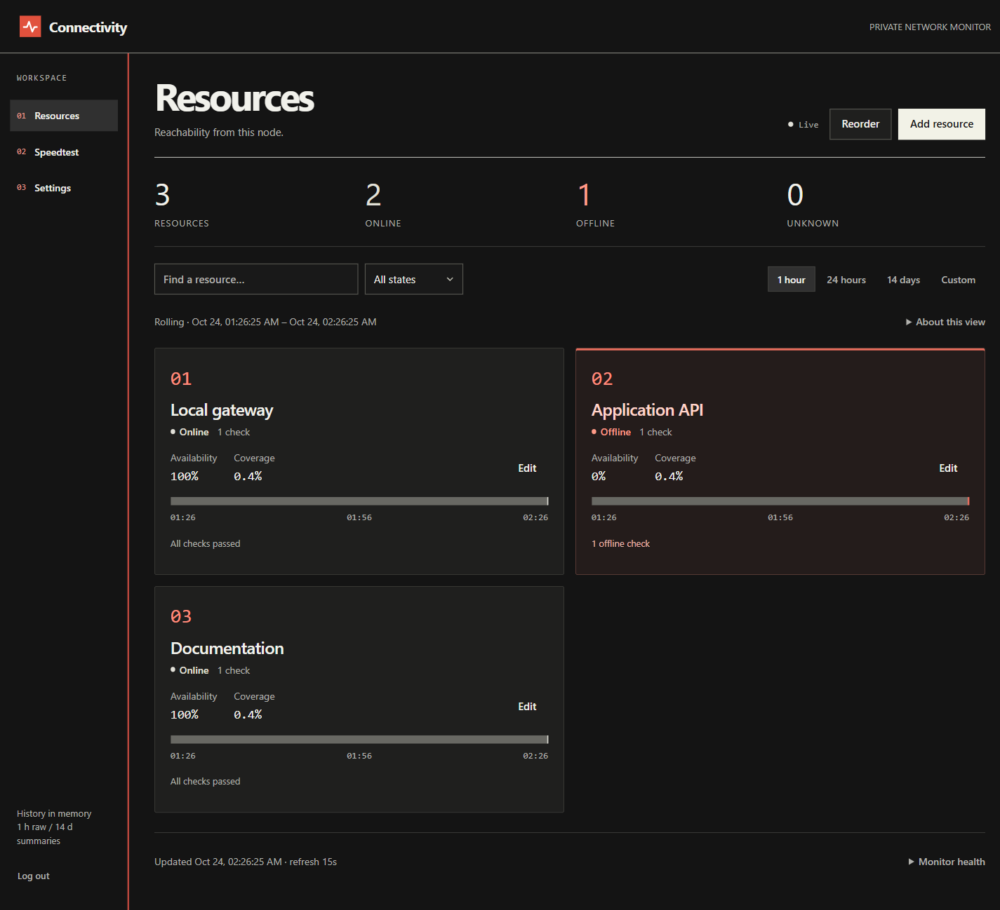

# Connectivity

Private, self-hosted monitoring for websites, servers and network devices. See what is reachable **from the machine running Connectivity**, how quickly it responds, and when it fails.



## Features

- **Ping, HTTP, TCP and TLS** checks, with individual schedules and timeouts.
- Up to **50 resources and 200 checks**. Add, edit and reorder them in the browser.
- Dark, responsive dashboard with availability, latency, certificate expiry and failure details.
- Rolling history: one hour of detailed results and fourteen days of summaries. Choose presets or **Show last … hours/days**.
- Manual browser-to-server and server-to-server speed tests, including latency under load.
- One owner password; optional HTTPS at a root URL or path prefix.

**Restarting clears history, sessions and speedtest results.** There are no alerts, persistent result storage or separate user accounts. Speed tests can saturate a connection and transfer gigabytes.

## Install and run

Install **Python 3.14**, pip and venv. Linux also needs `iputils-ping`. Run Connectivity as a regular user.

Clone or download [this repository](https://github.com/edubovit/connectivity), then open a terminal in its directory.

### Linux / macOS

```sh
python3.14 -m venv .venv
.venv/bin/python -m pip install -r requirements.lock
.venv/bin/python -m pip install --no-deps .
mkdir -p .local
chmod 700 .local
cp connectivity/example.yml .local/config.yml
chmod 600 .local/config.yml
```

### Windows PowerShell

```powershell
python -m venv .venv
.\.venv\Scripts\python.exe -m pip install -r requirements.lock
.\.venv\Scripts\python.exe -m pip install --no-deps .
New-Item -ItemType Directory -Force .local
Copy-Item connectivity\example.yml .local\config.yml
```

On Windows, `python` must select Python 3.14. Restrict the configuration file and its directory to your account.

**Before starting**, edit `.local/config.yml` and replace `CHANGE_ME_BEFORE_STARTING` with a strong, unique password.

```sh
# Linux / macOS
.venv/bin/python -m connectivity --config .local/config.yml
```

```powershell
# Windows
.\.venv\Scripts\python.exe -m connectivity --config .local\config.yml
```

Open **http://127.0.0.1:8080**, sign in, and select **Add resource**. Stop with Ctrl+C.

## Configure

Use the dashboard to manage checks, peers and settings. Changes are saved to YAML when you select Save. Checks default to a **30-second interval** and **5-second timeout**; dashboard refresh defaults to **30 seconds**.

- **Availability** excludes unknown time. **Coverage** tells you how much of the selected window was observed.
- **Reordering:** drag a grip or use its keyboard controls, then save the order.
- **Peers:** Speedtest → Configure peers; enter the other node's exact URL and owner password. This credential grants full owner access.
- **Manual YAML edits:** stop the app, edit the file, then restart. Keep existing resources and credentials.

Keep this a private tool. Passwords are stored in the configuration file, and HTTP does not encrypt them. Restrict access with your network/firewall; use HTTPS for remote browser and peer connections.

[Configuration](docs/CONFIGURATION.md) · [HTTPS](docs/REVERSE_PROXY.md) · [Linux service](docs/SYSTEMD_SERVICE.md) · [Upgrades](docs/UPGRADING.md)
